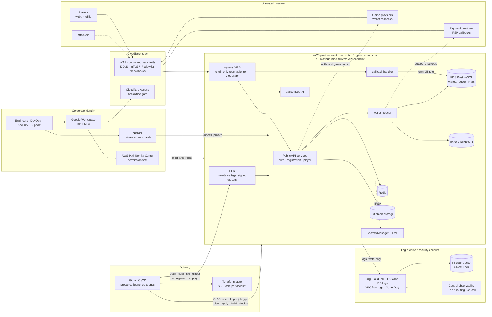

# Platform Security Engineer / DevSecOps — Technical Assessment

Supporting code lives in [`remediation/`](remediation/). Assumptions, trade-offs, open questions and AI-use disclosure are in [Section 6](#6-assumptions-trade-offs-open-questions-ai-use).

**How to read this.**
- Every control is tagged with what it does: **[P]** prevention, **[D]** detection, **[R]** response, **[E]** compliance evidence.
- Priorities: **P0** = launch blocker, in place before launch. **P1** = due within 30 days after launch, earlier where possible. **P2** = hardening backlog. Launch is eight weeks (56 days) away.
- Owners: "Platform lead" and "Platform engineer #2" are the two DevOps/Platform engineers. "Backend Tech Lead (payments)" and "Backend Tech Lead (identity)" are the two Tech Leads. "Security" is this role. The Head of Support and the CTO are outside the engineering team; they appear only as a co-owner (R5) and as alert recipients.

---

## 1. Risk and Security Architecture

### 1.1 Trust-boundary diagram



IRSA (IAM Roles for Service Accounts) maps one Kubernetes service account to one IAM role, so each app gets only its own AWS access. On its own it doesn't stop a pod from also taking the node's role from the instance metadata service; IMDSv2 with hop limit 1 (R3) does that.

**Trust boundaries and what crosses them**

| # | Boundary | Crossing | Main control |
|---|----------|----------|--------------|
| 1 | Internet → edge | Player traffic, PSP and game-provider callbacks | Cloudflare WAF, rate limiting and bot management. Callbacks also need a signature check, and mTLS or an IP allowlist where the provider supports it. The origin accepts traffic only from Cloudflare (Authenticated Origin Pulls plus a security group of Cloudflare IP ranges). |
| 2 | Edge → prod VPC | HTTP to ingress only | Workloads sit in private subnets. No data store has a public endpoint. |
| 3 | Delivery → prod | Terraform apply, image push, deploy | GitLab OIDC (OpenID Connect) issues short-lived credentials for one role per job type: plan, apply, build, deploy. Each role is bound to its projects, the `main` branch and its runners' network. No static keys. The production environment needs an approval from someone other than the person who triggered the pipeline. |
| 4 | Prod → log-archive account | Logs flow one way | CloudTrail, EKS and database logs are copied to the log-archive account. The prod account can't read, change or delete them there: Object Lock in compliance mode, plus SCPs (service control policies: AWS Organizations rules that even account admins can't override). Security reads them; on-call responders get read access through JIT during an incident. |
| 5 | Staff → prod | Human admin access | Google SSO with MFA → Identity Center → view-only by default, with time-limited elevation on request. The cluster API is reachable only over NetBird. |
| 6 | Prod → third parties | Payouts, game launch | Egress allowlist through a NAT or egress proxy. Each partner has its own credentials in Secrets Manager. |

### 1.2 Eight highest launch risks

Sorted by priority (all P0s first), then by likelihood × impact within each priority. Impact counts three things: direct financial loss; licence exposure with Tier-1 regulators such as the UK Gambling Commission (UKGC) and the Malta Gaming Authority (MGA); and player-data breach.

| # | Risk (asset — realistic threat) | Impact | Proposed control | Verification evidence | Owner | Pri |
|---|---|---|---|---|---|---|
| R1 | **CI/CD → prod takeover.** Asset: AWS prod account. Threat: a leaked CI key, a malicious merge request (MR) or a compromised runner uses the `gitlab-ci` policy (`*:*`, every action on every resource) | Full account compromise, data theft and ledger tampering. This is the incident scenario in Part 3. | **[P]** GitLab OIDC federation to one short-lived role per job type: Terraform plan (read-only), Terraform apply (admin, but fenced away from the CI identities, cluster access and image signing), image build (push only) and deploy (sign and roll out only). Each role trusts only `main` of its projects and works only from its runners' network. Apply and deploy also need an approval. Delete the IAM user keys. Prod jobs run on dedicated runners. An SCP blocks new IAM users and access keys. **[D]** Alert when a CI role is used from an address that isn't a runner. | No policy grants `*:*` except the fenced apply role (script over `aws iam get-account-authorization-details`). The IAM credential report shows no active access keys in prod. CloudTrail shows CI roles assumed only through `AssumeRoleWithWebIdentity` from GitLab. | Platform lead | **P0** |
| R2 | **Wallet / ledger database exposure.** Asset: `wallet-prod` RDS. Threat: internet scanning and credential stuffing against a public Postgres, using the password leaked in Git (Part 2B); theft of an unencrypted snapshot | Player funds and personal data (PII) breach, regulator notification, licence risk. Unrecoverable data loss (1-day backups, no final snapshot). | **[P]** Isolated database subnets, no public address. A security group that admits only the wallet and callback-handler pods (EKS security groups for pods). KMS encryption, deletion protection, a final snapshot, 35-day point-in-time recovery. Credentials in Secrets Manager with rotation, and a separate database role per service. An SCP blocks sharing or exporting snapshots. Backups copied to a second account (P1). | AWS Config rules `rds-instance-public-access-check` and `rds-storage-encrypted` pass. A restore drill is recorded, with the recovery time and recovery point it achieved. | Platform engineer #2 | **P0** |
| R3 | **Cluster and workload compromise.** Asset: EKS `platform-prod`. Threat: a public API endpoint open to `0.0.0.0/0`, a privileged root container and the default service account let one remote code execution (RCE) in an app escape to the node, and from there reach secrets and the node's IAM role | Lateral movement to every namespace's secrets and to the wallet database. | **[P]** Private endpoint, reachable over NetBird. Pod Security `restricted` in every application namespace: Pod Security Admission labels, plus a policy in Kyverno (a Kubernetes admission-policy engine) for namespaces without them. Kyverno also admits only images from the prod registry, pinned by digest and signed. A dedicated service account per app; IRSA only where the app calls AWS. Default-deny NetworkPolicies. IMDSv2 with hop limit 1, so pods can't take the node's IAM role from the instance metadata service. Secrets come in through External Secrets (which syncs them from AWS Secrets Manager), never as plain values in Git. **[D]** EKS audit logs and GuardDuty EKS Runtime Monitoring. | Kyverno PolicyReports show 0 violations. `kubectl auth can-i --list` per service account. The purple-team test in Part 4 confirms both blocking and detection. | Platform lead | **P0** |
| R4 | **Forged or replayed money callbacks.** Asset: wallet balance and ledger. Threat: an attacker forges or replays a payment service provider (PSP) deposit callback or a game-provider win, or races concurrent bet/win/rollback calls | Direct financial loss, often found only during reconciliation. | **[P]** Check the HMAC or provider signature, the timestamp window and a nonce before any business logic runs. Use idempotency keys with a unique database constraint. Double-entry ledger, with balance changes done in a transaction with `SELECT … FOR UPDATE` (row locking) or serializable isolation. Cloudflare allowlist per provider. **[D]** Daily reconciliation against PSP and provider reports, with alerts on any mismatch. | Contract tests in CI must reject unsigned, expired, replayed and out-of-order callbacks. The reconciliation job runs and its dashboard is green. A pentest item covers this. | Backend Tech Lead (payments) | **P0** |
| R5 | **Backoffice privilege abuse.** Asset: backoffice, which can adjust balances, approve withdrawals and see personal data. Threat: phishing of a support agent, an insider, or a missing authorization check (IDOR: changing an ID in a request reaches another player's data) | Fraudulent payouts, mass personal-data exposure, anti-money-laundering (AML) failures. | **[P]** Reachable only through Cloudflare Access or NetBird, with Google SSO and phishing-resistant MFA. Role-based access by tier. Four-eyes approval for manual balance adjustments and for withdrawals above a threshold. Personal data masked by default. **[D][E]** An append-only audit log of every privileged action (who, what, before/after, ticket), shipped to the log archive. | An authorization test matrix runs in CI, one row per role and endpoint. A quarterly access review is signed off. Audit-log samples are in the evidence pack. | Backend Tech Lead (payments) + Head of Support | **P0** |
| R6 | **We can't see or prove what happened.** Asset: audit trail. Threat: the attacker or an insider deletes the logs, or nobody is alerted. `platform-audit-prod` has no protection settings at all. | We can't detect or scope an incident, which is a regulatory breach (audit-trail retention), and we can't defend disputes. | **[P]** Organisation CloudTrail (all regions; management events, plus data events for the buckets that hold player documents and exports) into the log-archive account. EKS and database logs streamed there too. Audit bucket: S3 Object Lock in compliance mode, KMS, Block Public Access, TLS-only bucket policy. SCPs deny stopping or changing trails, switching off GuardDuty or Config, and changing the audit bucket's policy, encryption, retention or key. **[D]** GuardDuty (EKS, RDS, S3 protection), VPC flow logs, and about 10 starter alerts routed to on-call. | CloudTrail log-file validation passes. Deleting an object version (`DeleteObject` with a `VersionId`) is denied. A synthetic GuardDuty finding reaches the on-call pager within 5 minutes. | Security | **P0** |
| R7 | **Player account takeover (ATO) and withdrawal fraud.** Asset: player accounts and withdrawals. Threat: credential stuffing, SIM swap, or a changed payout method followed by an immediate withdrawal | Player loss, chargebacks, regulator complaints, reputational damage. | **[P]** Cloudflare rate limiting and bot management on login, registration and password reset. A check against breached passwords. MFA, and step-up authentication when a payout method changes or a withdrawal is made. A cool-down after payout details change. **[D]** Alerts on spikes of failed logins per network (ASN) or device, and on velocity rules. | A load test of the login endpoint confirms the rate limits. QA tests the step-up flows. The fraud dashboard has an owner. | Backend Tech Lead (identity) | **P1** |
| R8 | **Software supply chain.** Asset: build pipeline and images. Threat: `:latest` base and app images, Docker-in-Docker with a privileged runner, unscanned npm dependencies, unsigned images, mutable tags | A malicious or vulnerable image reaches prod, and nobody can trace which code runs where. | **[P]** Pin images by digest. Build without a Docker daemon (Buildah in an unprivileged container). Immutable ECR tags. Scan with Trivy (dependencies, IaC, images) and gitleaks. Generate an SBOM (software bill of materials). Sign the approved digest with cosign (container-image signing) and verify it at admission with Kyverno. Main-only builds, digest pinning and the signature check at admission are launch blockers and ship with R1 and R3; R8's own P1 work is the SBOM process and the dependency, IaC and image gates in blocking mode. **[E]** Every deploy can be traced to a commit, pipeline, image digest and approver. | Pipeline evidence: signed digest, SBOM artefact, scan reports. Kyverno rejects an unsigned test image (a regression test). | Platform engineer #2 | **P1** |

**Considered but ranked lower for launch.**
- DDoS: Cloudflare already covers most of it, so the work left is tuning.
- Kafka and Redis authentication (P1): both are private already, and R3's default-deny NetworkPolicies, which land before launch, limit which pods can reach them.
- Prod data copied into developer environments: the brief already forbids it. The SCP that blocks sharing or exporting prod snapshots ships with R2. Synthetic test-data tooling is P1.

### 1.3 Access model

**Principles.**
- Google Workspace is the single source of identity.
- Access is granted to groups, never to individuals.
- SCIM (automatic user and group provisioning) syncs Google groups to Identity Center, GitLab and NetBird.
- Nobody has standing write access to prod. Changes go through Terraform and CI, or through just-in-time (JIT) elevation that expires on its own.
- Every approval step has at least two people who can perform it.

| Role | dev | staging | prod AWS | prod K8s | Backoffice | Elevation |
|---|---|---|---|---|---|---|
| Backend engineer | PowerUser (no IAM) | Read + deploy via CI | `ViewOnly` (configuration only: no data, no secrets) | `view` in their team's namespaces (the built-in `view` role can't read secrets) | none (test tenant only) | JIT `ProdDebug` (logs, `exec` in their namespaces), 2 h, Tech Lead approves |
| Tech Lead | as engineer | as engineer | `ViewOnly` | `view` in their teams' namespaces | none | Approves engineer JIT and prod deploys |
| DevOps / Platform | Admin | Admin | `ViewOnly` | `view` cluster-wide, no secrets | none | JIT `PlatformAdmin` (AWS admin + cluster admin), 4 h; the other platform engineer or Security approves |
| Security | `SecurityAudit` | `SecurityAudit` | `SecurityAudit` + log-archive read + GuardDuty/Security Hub admin | `view` + audit logs | read-only audit view | JIT `IncidentResponder` (isolate, snapshot, quarantine), pre-approved during a declared incident |
| Support | none | none | none | none | Tiered: L1 read with masked personal data; L2 limited actions; payment actions need a second approver | Manager-approved tier change |
| Break-glass | — | — | 2 IAM users that can only assume the `break-glass-admin` role, plus the management account's root user; FIDO2 hardware keys | `break-glass-admin` has a cluster-admin access entry | — | Emergency only, see below |

**Joiner.** HR creates the Google account. The manager requests role groups in the access-request tracker. The group owner approves it, not the requester. SCIM provisions Identity Center, GitLab and NetBird. The default is the least-privileged group for the role. Prod read access arrives only after onboarding and security training are done. **Evidence:** the ticket ID is linked in the group-change audit log.

**Mover.** A role change is a request that adds the new groups *and removes the old ones in the same change*, approved by the new manager. Any JIT eligibility that no longer fits is revoked. **Evidence:** a monthly automated diff of group memberships against the HR role.

**Leaver.** HR offboarding suspends the Google account. That kills SSO and, through SCIM, removes Identity Center, GitLab and NetBird access within minutes. Identity Center sessions that are already open would otherwise run until they expire, so a deny policy on the person's user ID cuts them off. A NetBird peer removal runs as an automated hook. A check confirms the person had no personal access tokens or keys; by design there should be none. Same day for involuntary leavers, end of the last day for others. **Evidence:** a leaver checklist with timestamps, and a quarterly access review that catches drift.

**Temporary access (JIT).** The engineer asks for an eligible elevated permission set. The tool is AWS TEAM (Temporary Elevated Access Management, AWS's open-source approval app) or an Identity Center assignment created by an approved GitLab job. They give a reason and a ticket. A peer approves, never the requester. The grant is time-limited and expires automatically. CloudTrail records the session with the requester's identity, and a summary goes to a Slack channel. Self-approval is impossible, and two approvers exist per role so the flow never depends on one person.

**Emergency access (break-glass).** This covers the case where SSO or Identity Center is unavailable, or JIT is too slow during a declared SEV1 (the highest incident severity).
- Two prod break-glass IAM users, each with a FIDO2 key held by a different named person. They can do nothing except assume `break-glass-admin`, which has admin rights and the cluster-admin access entry. Passwords are in a sealed vault and need two people to retrieve. The management account's root user uses the same pattern.
- Any sign-in, and any assumption of `break-glass-admin`, pages Security and the CTO immediately. This is an EventBridge rule on `ConsoleLogin` and `AssumeRole` for those principals.
- The CI roles can't change these identities (§2.2), and the SCPs exempt them, so they still work when a guardrail is in the way.
- After use: rotate the credentials, write a post-incident review within 24 h, and replay the CloudTrail for the session.
- A quarterly test sign-in proves that it works and that the alert fires.

### 1.4 First 30 days — five controls

| # | Control | Covers | Why it outranks the rest |
|---|---|---|---|
| 1 | **Close public exposure of prod data and the control plane.** RDS goes private and encrypted (encrypted snapshot copy → restore in a maintenance window), with deletion protection and 35-day point-in-time recovery. The EKS endpoint goes private, reachable over NetBird. The origin accepts only Cloudflare. The backoffice is reachable only through Cloudflare Access. | R2, R3, R5 | These are publicly reachable right now. Anyone can exploit them without credentials. Fixing them is cheap and fully in the platform team's hands. |
| 2 | **Remove static, over-privileged CI credentials.** GitLab OIDC: one short-lived role per job type, bound to `main` and its runners' network. Protected `production` environment with an approval rule. Prod jobs run on dedicated runners. | R1, R8 | The CI role is the single path from "one leaked secret" to "own the account", as the Part 3 incident shows. It also gives deploys a traceable approval, which auditors will ask for. |
| 3 | **Tamper-proof audit trail and baseline detection.** Organisation CloudTrail → log-archive account with Object Lock. EKS audit logs and database logs streamed there. GuardDuty. About 10 high-signal alerts routed to on-call. | R6 (and detection for all of them) | It's a regulatory requirement, and without it we can't respond to anything else. It has to exist *before* launch traffic, because logs can't be collected after the fact. |
| 4 | **Workload baseline.** Pod Security `restricted` in every namespace, through admission labels plus Kyverno (first in audit, then enforce). A service account per app; IRSA only where the app calls AWS. External Secrets + Secrets Manager. Rotate every secret that was ever in Git or a manifest. | R3 | It turns a single app RCE into a contained incident instead of a cluster-wide breach. Starting in audit mode keeps delivery running (Part 2 rollout plan). |
| 5 | **Money-path integrity: callback signature and replay protection, idempotency, reconciliation.** | R4 | This is the most direct path to financial loss, and it's specific to iGaming. Backend engineers own it, so it runs in parallel with 1–4 without competing for the two platform engineers. |

**R5 is a launch blocker, but only part of it lands in the first 30 days.** Control 1 puts the backoffice behind Cloudflare Access with SSO and MFA, which removes the internet-facing risk. Four-eyes approvals and the append-only audit log are application features. The backend team builds them in weeks 5–8, and launch waits for them.

**Deliberately deferred to weeks 5–8 (days 29–56), still before launch.**
- Launch waits for these (P0):
  - image signatures enforced at admission (R3);
  - default-deny NetworkPolicies in prod (R3);
  - the backoffice's four-eyes approvals and audit log (R5).
- Planned for the same weeks, but launch doesn't wait for them (P1):
  - JIT tooling for every role;
  - the dependency and image gates blocking HIGH findings;
  - player account-takeover protections and step-up flows (R7);
  - the first formal access review.

Until JIT tooling exists, only a short list of named people get prod write access, and CloudTrail alerts watch it. The trade-off: some manual approval work for about a month, in exchange for shipping the controls that stop internet-reachable compromise first.

**Who does what, week by week.** Two platform engineers can't do all of this alone. Security (this role) takes the logging, guardrail and admission work, and the backend team owns the money path. "Step" refers to the Terraform order in §2.2.

| Weeks | Platform lead | Platform engineer #2 | Security | Backend team |
|---|---|---|---|---|
| 1 | CI OIDC roles next to the old key; protected `production` environment; prod-deploy runner inside the VPC (step 4) | Wallet database: rotate the leaked password; deletion protection and backups; make it private (steps 1–2) | Log-archive bucket, organisation CloudTrail, SCPs (step 7); secrets gate | Callback signature and replay checks (R4) |
| 2 | Move pipelines to OIDC one at a time; EKS public endpoint limited to runner and NetBird addresses; origin accepts only Cloudflare | Rehearse the encrypted restore in staging (step 3) | GuardDuty; ten starter alerts to on-call; gate baseline (§2.6) | Idempotency keys and ledger locking (R4) |
| 3–4 | Delete the old CI key; EKS public endpoint off; access entries and audit logs (steps 5–6) | Encrypted restore in prod (step 3); database access narrowed to pod security groups; External Secrets for every service | Backoffice behind Cloudflare Access; Kyverno registry rule and Pod Security enforced (§2.6) | Reconciliation job (R4) |
| 5–6 | Signature check enforced; NetworkPolicies, staging then prod | Backups to a second account (R2); IMDSv2 hop limit on all nodes | HIGH findings block; baseline exceptions cleared; pentest preparation (Part 5) | Four-eyes approvals and audit log (R5); step-up flows (R7) |
| 7–8 | Launch freeze; fix pentest findings | Restore drill with measured recovery time and recovery point | External pentest and retest | Fix pentest findings |

---

## 2. Practical Review and Remediation

The corrected files are in [`remediation/`](remediation/). The original snippets, with the Markdown escapes removed, are in [`remediation/original/`](remediation/original/) for comparison.

| Original | Replaced by |
|---|---|
| 2A Terraform | `terraform/`: `ci-oidc.tf`, `eks.tf`, `eks-access.tf`, `rds-wallet.tf`, `audit-logging.tf`, `ecr.tf`, `image-signing.tf`, `org-guardrails.tf`, `log-shipping.tf`, `irsa-callbacks.tf`. `versions.tf` lists which stack each file belongs to. |
| 2B Deployment | `k8s/`: `namespace.yaml`, `callback-handler.yaml`, `rbac-ci-deployer.yaml`, `kyverno-policies.yaml` |
| 2C Pipeline | `gitlab/`: `.gitlab-ci.yml`, `security-gates.yml` (central template), `CODEOWNERS`, `.trivyignore` |

**Severity.**
- **Critical:** exploitable now, by an outsider or by anyone holding one leaked credential, with a direct path to production data, funds or code.
- **High:** makes a breach much worse, or blocks detection and recovery.
- **Medium:** resilience and defence in depth.

Priority uses the Part 1 scale: P0 is a launch blocker, P1 is due within 30 days after launch.

### 2.1 Prioritised findings

| # | Finding | From | Severity | Priority | Why it ranks here |
|---|---|---|---|---|---|
| 1 | The CI IAM policy allows every action on every resource | 2A | Critical | P0 | One leaked CI credential, malicious merge or compromised runner owns the prod account: data, ledger, logs. This is the root of the Part 3 incident. |
| 2 | Any branch can put code into production | 2C, 2B | Critical | P0 | `build` runs on every branch and pushes `:latest`, and prod runs `:latest`. Kubernetes pulls a `:latest` image again for every new pod (the default `imagePullPolicy` for that tag is `Always`). So unreviewed branch code reaches prod on the next node drain, with no deploy at all. |
| 3 | Production database password in plain text in the manifest | 2B | Critical | P0: rotate today | It's in Git history and every clone, and anyone who can `get deployments` can read it. Combined with #4, anyone who ever saw the repo can log in to the wallet database from the internet. |
| 4 | The wallet database is publicly accessible | 2A | Critical | P0 | An internet-reachable Postgres holding balances and personal data. A password is its only protection, and that password is #3. |
| 5 | callback-handler runs privileged, as root | 2B | Critical | P0 | The service that parses untrusted internet input can escape to the node in one step. From there it reaches other pods' secrets, the node's IAM role and the kubelet's credentials. |
| 6 | The prod deploy has no approval, no environment, and inherited credentials | 2C | Critical | P0 | Whatever reaches `main` ships at once. The job sets no AWS identity, so it uses whatever the runner provides: most likely project CI variables holding the `*:*` key. If those variables aren't marked protected, which the snippet doesn't show, jobs on any branch can read them. Nothing records the deployment. |
| 7 | The wallet database can be destroyed or lose data | 2A | High | P0, applied first | 1-day backups, no final snapshot, no deletion protection. A `terraform destroy`, or any change that forces replacement (such as fixing #8 the naive way), deletes the ledger without a snapshot. |
| 8 | The wallet database is not encrypted at rest | 2A | High | P0 | Anyone who can copy the storage or a snapshot can read it. This can't be fixed in place (§2.2 step 3). |
| 9 | The EKS API is open to `0.0.0.0/0`, the private endpoint is off, and the cluster sits in public subnets | 2A | High | P0 | Stolen credentials (Part 3, 02:27) work from anywhere, and the API server faces internet scanning. Not Critical, because the API still needs valid credentials. |
| 10 | EKS control-plane logs are off, and the cluster creator is a hidden admin | 2A (missing) | High | P0 | Without audit logs, the Part 3 incident can't be investigated. Whoever created the cluster, most likely the CI identity, keeps a cluster-admin right that appears in no RBAC binding. So the infrastructure pipeline stays a hidden cluster admin. |
| 11 | The audit bucket has no immutability or retention, and it sits in prod | 2A | High | P0 | An attacker with #1 deletes the evidence. Licence conditions expect a tamper-proof audit trail. |
| 12 | The workload uses the `default` service account, with its token mounted | 2B | High | P0 (cheap) | Every pod in the namespace shares one identity. Code execution in the pod hands over a Kubernetes API token. |
| 13 | Build job: privileged Docker-in-Docker, and the registry password on the command line | 2C | High | P0 | On a shared, long-lived runner, privileged Docker-in-Docker gives every job root on the host and access to other jobs' secrets. `-p` puts the password in the process list. Fixed by separate build and prod-deploy runners and a build without a Docker daemon. |
| 14 | The pipeline has no security checks | 2C | High | Secrets gate P0; the rest P1, phased (§2.6) | Nothing stops a leaked secret, a known-vulnerable package or a misconfiguration. The other gates aren't P0 on purpose: turning every gate to blocking at once would stop all deploys. |
| 15 | No NetworkPolicies | 2B (missing) | High | P0, last (weeks 5–6) | Any compromised pod can reach every database, every queue and the internet. It lands last because the traffic must be mapped in staging first; a wrong policy is an outage. |
| 16 | One replica, and no resource limits, probes or disruption budget | 2B | Medium | P1 | Callbacks fail during node drains, and providers retry or give up; reconciliation only catches the difference later. A pod without limits can starve its node. |
| 17 | The deploy job doesn't wait for the rollout, can't roll back, and can run in parallel | 2C | Medium | P1 | A crash-looping release shows green. Two pipelines can run their deploys at the same time. |

Two chains matter more than any single row:
- #3 + #4: anyone can log in to the wallet database from the internet with a password taken from Git.
- #1 + #9 + #12: this is the attack path of the Part 3 incident.

The API server would also reject the Deployment snippet as written: an `apps/v1` Deployment needs a `selector` and pod labels. It sets no namespace either, so it lands wherever the deploy context points.

### 2.2 Terraform / AWS

**Launch blockers, with their operational consequences.** The order matters within each resource: database steps 1 → 2 → 3, cluster steps 5 → 6. Steps 4 and 7 can run in parallel with them (week plan in §1.4).

| Step | Change (file) | Operational consequence | Downtime |
|---|---|---|---|
| 1 | Wallet DB: deletion protection, final snapshot, 35-day point-in-time recovery, `prevent_destroy` (`rds-wallet.tf`). Applied in place; none of it waits for the maintenance window. | Deleting the database now takes two deliberate steps. Backup storage cost grows with 35 days of history. | None |
| 2 | Wallet DB goes private: `publicly_accessible = false`, and a security group that admits only pods carrying the database-client security group (`rds-wallet.tf`; the pods get it from a SecurityGroupPolicy, §2.3) | Every client outside the VPC loses access: laptops, BI tools, migrations run from CI. Migrations become in-cluster Jobs with the wallet's security group. Human access to the database becomes a JIT exception, not a standing path. If security groups for pods aren't ready yet, admit the nodes' security group first and narrow it in weeks 3–4; that is still far better than the internet. | Seconds (DNS switches to the private address) |
| 3 | Restore into the end state: encryption, the isolated subnet group and the TLS-only parameter group (`rds-wallet.tf`) | Encryption can't be turned on in place: Terraform would plan destroy-and-recreate, which with the original `skip_final_snapshot = true` loses the ledger. RDS also can't move an instance to another subnet group in the same VPC, and a new parameter group waits for a reboot. So all three arrive with one restore: stop writes → snapshot → copy the snapshot with the KMS key → rename the old instance → restore the copy as `wallet-prod` with the new subnet group and parameter group → import it into Terraform → keep the old instance stopped for a week. The endpoint name stays the same, so apps need no change, but they must now connect with TLS (already the default on PostgreSQL 15 and later). The parameter group assumes PostgreSQL 16; the brief doesn't give a version. Before launch the database is small, so the window is short. After launch this would need logical replication. | One maintenance window, rehearsed in staging |
| 4 | CI: four OIDC roles, one per job type, added alongside the old key (`ci-oidc.tf`). Pipelines move over one at a time. The old key is deleted after 5 working days with no use in CloudTrail. | Build runners and the prod-deploy runner need fixed egress addresses (NAT), as two separate sets: each role accepts calls only from its own runners. Anything outside GitLab that used the key breaks, so find it first through IAM "last used" data. | None |
| 5 | EKS private endpoint and private subnets (`eks.tf`). First allow only the runner and NetBird addresses on the public endpoint, then switch the public endpoint off. | kubectl needs NetBird. The deploy runner must sit inside the VPC. With AWS provider 6.69.1, Terraform plans the subnet move as an in-place update (checked with a plan). Read the plan anyway: older provider versions may want a new cluster. | None if sequenced |
| 6 | EKS audit logs on, kept 90 days in CloudWatch and streamed to the log archive (`eks.tf`, `log-shipping.tf`). Access entries replace the `aws-auth` ConfigMap (`eks-access.tf`), and the creator's hidden admin right is removed. | Audit logs cost money to ingest; filter them in the observability pipeline, not at the source. The authentication mode moves one step per apply: `CONFIG_MAP` → `API_AND_CONFIG_MAP` (copy the mappings into access entries) → `API`. On the existing cluster, delete the creator's access entry. Changing `bootstrap_cluster_creator_admin_permissions` there would force a new cluster (checked with a plan), so `eks.tf` sets it for new clusters only and ignores it afterwards. | None |
| 7 | New audit bucket in the log-archive account with Object Lock, and an organisation CloudTrail (`audit-logging.tf`). SCPs on the prod and log-archive organisational units (`org-guardrails.tf`). | Nobody can shorten compliance-mode retention, so rehearse it in governance mode in staging. Nothing written there can be erased early, including personal data, so player data stays out of audit events. The SCPs stop anyone in those accounts from switching off trails, GuardDuty or Config, or from changing the audit bucket's policy, encryption, retention or key. Only the break-glass identities, the backup role and a log-archive admin role (two people, with an alert) are exempt. | None |

**How CI gets AWS credentials after the change** (`ci-oidc.tf`). Each GitLab job exchanges its OIDC ID token for 1-hour credentials.
- Each role trusts one token audience and the `main` branch of its projects.
- A job receives a token only for the audience its YAML declares.
- So code running in the build job, such as a compromised npm package, cannot assume the deploy role, even though both jobs come from the same project and branch.
- Each role works only from its own runners' network addresses.

| Role | Who can assume it | Can | Cannot |
|---|---|---|---|
| `gitlab-tf-plan-prod` | infra project, `main` only (merge-request plans run against staging), from the build runners | read configuration (`ReadOnlyAccess`) | read secrets or parameters, or S3 objects other than the workload stack's state |
| `gitlab-tf-apply-prod` | infra project, `main`, after the environment approval, from the prod-deploy runner | change infrastructure: admin inside the account | change the CI roles, the OIDC provider or the break-glass identities; assume other roles; grant cluster access; run commands on nodes through SSM (AWS Systems Manager); use or re-key the image-signing key; anything the SCPs forbid |
| `gitlab-build-prod` | service projects, `main`, from the build runners | push to the service ECR repositories, and read them for the image scan | deploy, sign, read secrets |
| `gitlab-deploy-prod` | service projects, `main`, from the prod-deploy runner; only the approved deploy job asks for this audience | read service images, sign the digest, write the signature to `image-signatures`, describe the cluster; in Kubernetes, patch Deployments in the service namespaces | push images; read secrets, exec into pods or create pods directly through the Kubernetes API |

The CI roles, the cluster access entries, the image-signing key and the SCPs live in a separate identity stack. People apply it with JIT admin; CI never does. That is why the apply role can be fenced away from them.

```hcl
# ci-oidc.tf (excerpt)
  infra_main_subs   = ["project_path:${var.infra_project_path}:ref_type:branch:ref:main"]
  service_main_subs = [for path in values(var.services) : "project_path:${path}:ref_type:branch:ref:main"]

  # In each role's trust policy (one role per job type: tf-plan, tf-apply, build, deploy):
    condition {
      test     = "StringEquals"
      variable = "${local.gitlab_host}:aud"
      values   = ["aws-prod-${each.key}"]
    }
    condition {
      test     = "StringLike"
      variable = "${local.gitlab_host}:sub"
      values   = each.value.subs
    }
```

Three limits of this design, stated openly:
- **The network condition does not protect the Kubernetes API.** An EKS token is a presigned `sts:GetCallerIdentity` call, and IAM cannot deny that call. The private endpoint is what keeps stolen credentials away from the cluster.
- **The trust policy cannot check the GitLab environment.** AWS matches only the token's audience and subject, not its `environment` claim. So someone who can merge to `main` of a service project could add a job that asks for the deploy audience and skips the approval. Merging needs an approved merge request plus a Platform code-owner approval for the pipeline file, so this still takes two people. The deploy role also works only from the prod-deploy runner.
- **The apply role is admin inside the account, by necessity:** Terraform manages IAM. Three things contain it:
  - who can trigger it: protected `main`, an approval, and the prod-deploy runner only;
  - the fence policy, which keeps it away from the CI and break-glass identities, other roles, cluster access, SSM commands on nodes and image signing;
  - the SCPs.

```hcl
# rds-wallet.tf (excerpt)
  # Was: publicly_accessible = true (step 2, in place)
  publicly_accessible    = false
  vpc_security_group_ids = [aws_security_group.wallet_db.id]
  # New with the restore (step 3): RDS cannot switch to another subnet group in the same VPC,
  # and a new parameter group would otherwise wait for a reboot.
  db_subnet_group_name = aws_db_subnet_group.wallet.name
  parameter_group_name = aws_db_parameter_group.wallet.name # rds.force_ssl = 1

  # Was: storage_encrypted = false (step 3, restore from an encrypted snapshot copy)
  storage_encrypted = true
  kms_key_id        = aws_kms_key.wallet_db.arn

  # Was: backup_retention_period = 1, skip_final_snapshot = true (step 1, in place)
  backup_retention_period   = 35
  deletion_protection       = true
  skip_final_snapshot       = false
  final_snapshot_identifier = "wallet-prod-final"

  manage_master_user_password = true # RDS stores and rotates it in Secrets Manager

  lifecycle {
    prevent_destroy = true
  }
```

```hcl
# eks.tf (excerpt)
  vpc_config {
    subnet_ids              = var.private_subnet_ids # was var.public_subnet_ids (step 5)
    endpoint_private_access = true                   # was false
    endpoint_public_access  = false                  # was true, open to 0.0.0.0/0
  }

  access_config {
    authentication_mode = "API" # step 6: via API_AND_CONFIG_MAP, two applies
    # New clusters only: changing it on an existing cluster forces a new cluster.
    bootstrap_cluster_creator_admin_permissions = false
  }

  enabled_cluster_log_types = ["api", "audit", "authenticator"] # step 6

  lifecycle {
    # platform-prod keeps its old value; its creator's access entry is deleted instead.
    ignore_changes = [access_config[0].bootstrap_cluster_creator_admin_permissions]
  }
```

**Later hardening (not launch blockers):**
- A permissions boundary on the roles the apply role creates.
- Per-service build and deploy roles. Today one service's pipeline could push to another service's repository or patch its Deployment. Every production deploy still needs an approval and a signature.
- Explicit key policies for the EKS and RDS keys, and KMS encryption for the CloudWatch log groups.
- pgaudit, and IAM database authentication instead of passwords (the instance already allows it).
- Backups copied to a second account, in an AWS Backup vault with Vault Lock (P1, part of R2).
- A region-lock SCP.
- Access logs and cross-region replication for the audit bucket.

### 2.3 Kubernetes workload

The rewritten Deployment is in `k8s/callback-handler.yaml`. These lines close findings #3, #5 and #12:

```yaml
    spec:
      serviceAccountName: callback-handler # was: default
      automountServiceAccountToken: false  # the app never calls the Kubernetes API
      securityContext:
        runAsNonRoot: true
        runAsUser: 10001 # was: 0
        seccompProfile:
          type: RuntimeDefault
      containers:
        - name: app
          image: <prod-account-id>.dkr.ecr.eu-central-1.amazonaws.com/callback-handler@sha256:<digest>
          env:
            - name: DB_PASSWORD # same name, so no code change
              valueFrom:
                secretKeyRef: # synced from Secrets Manager by External Secrets
                  name: callback-handler-db
                  key: password
          securityContext:
            privileged: false # was: true
            allowPrivilegeEscalation: false
            readOnlyRootFilesystem: true
            capabilities:
              drop: ["ALL"]
```

The same folder holds the supporting objects:
- the `callbacks` namespace, with Pod Security Admission at `restricted` (`namespace.yaml`; in week 1 without the `enforce` label);
- a namespaced `ci-deployer` Role (`rbac-ci-deployer.yaml`). The deploy job can change a Deployment's image and watch the rollout. Through the Kubernetes API it can't read secrets, exec into pods or create pods directly. Admission control limits the pods that a Deployment change creates;
- four Kyverno policies (`kyverno-policies.yaml`), each with its own switch from Audit to Enforce:
  1. Pod Security `restricted` for every namespace except the system ones (`kube-system`, Kyverno, External Secrets), including any that lack the labels;
  2. images only from the prod registry, pinned by digest;
  3. images signed with the production release key (signatures in their own ECR repository);
  4. no pod may run as a `*-secrets-reader` service account. External Secrets uses that account to read from AWS; without this rule, anyone who can change a pod template could borrow its access. Enforced from day one;
- the External Secrets objects, and the IRSA role they use (`terraform/irsa-callbacks.tf`), which can read `prod/callbacks/*` in Secrets Manager and nothing else;
- default-deny NetworkPolicies with named exceptions, and a SecurityGroupPolicy that gives the pods the security group the wallet database admits.

**Operational consequences:**
- **Non-root image.** The image must run as a non-root user (`USER 10001` in the Dockerfile) and write only to `/tmp`. Test this in staging first. Node.js services rarely need anything more.
- **Password rotation comes first.** The leaked password is rotated before any other change, and the pods then need a rolling restart. Rewriting Git history is optional: rotation is what makes the old value useless.
- **New namespace.** The handler moves out of the `wallet` namespace, so a compromise of the internet-facing handler no longer sits next to the wallet's secrets (Part 3, 02:16). The ingress must point to the new namespace.
- **Security groups for pods.** The VPC CNI (the EKS network plugin) needs pod ENI mode (`ENABLE_POD_ENI`: each such pod gets its own network interface), and the nodes must be instance types that support it. A pod gets only the groups listed in its SecurityGroupPolicy, so the cluster security group is listed too; otherwise the pod loses DNS and other cluster traffic.
- **Gradual enforcement.** Pod Security and three of the four Kyverno policies start in warn or audit mode. NetworkPolicies go to staging first, then prod (§2.6). Once Kyverno enforces, pods can't start while it is down, so it runs with three replicas.

**Later hardening (not launch blockers):**
- The handler calls the wallet service instead of writing to the wallet database itself. Its database role, security group and database egress rule then go away.
- The database secret is mounted as a file instead of an environment variable. This needs an app change.

### 2.4 GitLab pipeline

What changes in `gitlab/.gitlab-ci.yml`:
- **Build.** The image is built with Buildah: no Docker daemon, and the build container is not privileged. It still runs as root inside its container; the ephemeral runner isolates jobs from each other.
- **Image identity.** The image is pushed under an immutable tag (`<commit>-<pipeline>`). Later jobs find it by that tag in ECR and use its digest from then on. They take no files or variables from the build job, whose code (npm packages, Dockerfile steps) is untrusted: a variable passed through a dotenv artifact would override the deploy job's own.
- **Branches.** Only `main` builds production images.
- **Deploy.** The deploy job runs only after the image scan, so from week 3 a failed scan stops it. It waits for an approval, then signs the digest and deploys it. The signature goes to a separate ECR repository, `image-signatures`, and only the deploy role can use the signing key. The job waits for the rollout and rolls back if it fails.

```yaml
deploy_prod:
  stage: deploy
  needs: # wait for both jobs, but take no files or variables from them
    - job: build
      artifacts: false
    - job: image_scan
      artifacts: false
  rules:
    - if: $CI_COMMIT_BRANCH == $CI_DEFAULT_BRANCH
      when: manual
  environment:
    name: production         # protected: approval by someone other than the triggerer
  resource_group: production # one production deploy at a time
  tags: [prod-deploy]        # protected runner inside the prod VPC
  id_tokens:
    AWS_ID_TOKEN:
      aud: aws-prod-deploy   # only this job asks for the deploy role
  script:
    # (ECR login and kubeconfig lines omitted; see the file)
    - DIGEST=$(aws ecr describe-images --repository-name callback-handler --image-ids imageTag="$IMAGE_TAG" --query 'imageDetails[0].imageDigest' --output text)
    - echo "$DIGEST" | grep -Eq '^sha256:[0-9a-f]{64}$'
    - REF="$REGISTRY/callback-handler@$DIGEST"
    - export COSIGN_REPOSITORY="$REGISTRY/image-signatures"
    - cosign sign --yes --tlog-upload=false --key awskms:///alias/image-signing-prod "$REF"
    - kubectl -n callbacks set image deployment/callback-handler app="$REF"
    - kubectl -n callbacks rollout status deployment/callback-handler --timeout=5m || { kubectl -n callbacks rollout undo deployment/callback-handler; exit 1; }
```

**Settings that live outside the YAML** (this assumes GitLab Premium or higher):
- **Protected branch `main`.** No direct pushes. Merge requests need one approval, never from the author. Code-owner approval is on (`gitlab/CODEOWNERS`). CODEOWNERS covers itself, so nobody can remove the Platform or Security review in the same change.
- **Merge checks.** "Pipelines must succeed" is on. The secrets scan runs only in merge-request pipelines, so this setting is what makes a finding block the merge.
- **Protected environment `production`.** Tech Leads and Platform engineers may run the deploy job. Each deploy needs one approval from five named approvers: two Tech Leads, two Platform engineers and Security. The person who triggered the pipeline can't approve it. With five approvers, no single absence blocks a release.
- **Central template.** Service pipelines include `platform/ci-templates` at the protected tag `v1`, which only Platform can move. Every service gets a gate change at once, without editing its own pipeline. On GitLab Ultimate, a pipeline execution policy can inject the gates even into a pipeline that drops the `include`. On Premium, the CODEOWNERS rule on `.gitlab-ci.yml` is what stops that.
- **Runners.** `build` runners are ephemeral and never see deploy credentials. The `prod-deploy` runner is protected, so it runs only jobs from protected branches, and it runs nothing else.
- **Variables.** Nobody can override pipeline variables when running a pipeline (minimum role: *No one allowed*). The static `REGISTRY_PASSWORD` and AWS key variables are deleted. Gate modes (`allow_failure`) live in the template, not in variables, so a project can't switch a gate off through a CI variable.

**Operational consequences:**
- **Every production deploy needs a second person.** At about 20 deploys a week, that is about four approvals a working day, spread over five approvers.
- **New build tool.** Dockerfiles build with Buildah instead of Docker. Most build unchanged, but each service's first Buildah build is tested in staging.
- **New runners.** A protected prod-deploy runner inside the prod VPC, and build runners with fixed egress addresses. Platform owns both.
- **Licence.** Protected environments with approval rules and code-owner approval need GitLab Premium or higher.
- **Failed releases roll back on their own,** and the pipeline shows red instead of a false green.

**Later hardening (not launch blockers):**
- Build provenance (SLSA) attestations signed with each image and checked by Kyverno, so admission can also verify which pipeline built it.
- Per-service build and deploy roles (listed in §2.2).

### 2.5 CI/CD security gates

| Gate | Tool and where it runs | Fails the pipeline when | Day one | Evidence |
|---|---|---|---|---|
| Secrets | gitleaks on the merge request's new commits; a nightly full-history scan of every repository, scheduled in the central template project (not part of the excerpts) | any new finding | Blocking | report artefact; nightly findings become rotation tickets |
| Dependencies | Trivy on the lockfile, every pipeline; `npm ci --ignore-scripts` | a CRITICAL vulnerability that has a fixed version; HIGH as well from weeks 5–6 | Report only | job log |
| Infrastructure as code | Trivy on Terraform, Kubernetes manifests and Dockerfiles | a HIGH or CRITICAL misconfiguration. HIGH is included from the start because Trivy rates few misconfigurations CRITICAL. | Report only | job log; reviewers also read the `terraform plan` in the merge request |
| Container image | Trivy on `main`, on the image found by its immutable tag; CycloneDX SBOM kept for 1 year | a fixed CRITICAL in OS or app packages; HIGH as well from weeks 5–6 | Report only | SBOM and scan result per image |
| Admission | Pod Security Admission and Kyverno, in the cluster | a pod that is privileged or runs as root; an image that is unsigned, tag-only or from another registry; a pod running as a secrets-reader account | Audit / warn; the secrets-reader rule enforced | Kyverno PolicyReports |
| Deployment approval | GitLab protected environment | always, for production, until someone other than the triggerer approves | Enforced | GitLab deployment record: who approved, which commit, when. The digest is in the deploy job log and in its signature. |
| Gate integrity | central template at the protected tag `v1`; CODEOWNERS on `.gitlab-ci.yml`, the ignore files and CODEOWNERS itself | a merge request changes the pipeline or an exception without the code owners' approval | Enforced | merge-request approval history |

**Why these tools.**
- Two platform engineers can't maintain many scanners. Trivy alone covers dependencies, IaC, images and the SBOM. gitleaks is better at scanning Git history.
- Admission control matters most, because it still holds when someone bypasses a pipeline.
- Every gate fails only on findings a developer can act on: vulnerabilities with a fixed version, secrets in new commits.

**Scanners don't see process failures.** Checkov's GitLab CI rules passed the original pipeline with zero findings (§2.7), although it had no approval, used admin credentials and ran `:latest` everywhere. Pipeline controls are verified by configuration review and by trying to break them. For example, a test merge request that tries to deploy without approval, or to assume the deploy role from the build job, must fail.

**Exceptions.**
- **Format.** Each dependency, IaC or image exception is an entry in the service's `.trivyignore`, with a ticket, an owner, a reason and an `exp:` date. Trivy honours the date: once it passes, the gate fails again. The longest expiry is 7 days for CRITICAL and 30 days for HIGH. The one exception to these limits is the week-2 baseline (§2.6): existing findings of any severity get up to 30 days, and all of them expire by week 6.
- **`.gitleaksignore`** holds only false positives and secrets that have already been rotated, each with a ticket. It has no expiry date, because neither kind becomes dangerous later.
- **Approval.** Security approves exceptions through CODEOWNERS. Tech Leads are deputies, so an exception never waits for one person. Security reviews deputy approvals in a weekly report of every exception's count, age and owner.
- **Leaked secrets.** A real leaked secret is never an exception. It is rotated first; only then is its fingerprint added to `.gitleaksignore`.
- **Emergencies.** There is no bypass switch. A hotfix blocked by a gate gets a normal exception with a 2-day expiry, which any code owner can approve in minutes. So every bypass is a reviewed, dated change that can be audited.

### 2.6 Rollout without breaking every deploy

The principle: block new problems immediately, put existing ones on a dated list, and switch on one gate at a time, each with a measured condition for moving on.

| Week | Change | Blocks | Move on when |
|---|---|---|---|
| 1 | OIDC roles alongside the old key; digest-based deploys; protected environment with approval; secrets gate on new commits; the other gates report only; Pod Security labels in `warn`/`audit`; Kyverno: the secrets-reader rule enforced, the other three in Audit | missing approval, new secrets, pods running as a secrets-reader account | the old CI key has gone unused for 5 working days → delete it |
| 2 | Baseline: every existing finding becomes an exception owned by the service's Tech Lead, expiring by week 6. Gate results go on a dashboard. | nothing new | every service has a reviewed baseline |
| 3 | Dependency and image gates block fixed CRITICAL findings; the IaC gate blocks HIGH and CRITICAL misconfigurations. Kyverno's registry-and-digest rule is enforced in every namespace except the system ones. | new CRITICAL findings, new HIGH misconfigurations; tag-only images, images from other registries | under 5% of pipelines are blocked by anything other than a real new finding |
| 4 | Pod Security `restricted` enforced: the `enforce` label on the service namespaces, and Kyverno's pod-security policy for all others | privileged or root pods | a week without warnings |
| 5–6 | Kyverno signature check enforced; dependency and image gates block HIGH; NetworkPolicies in staging, then prod; baseline exceptions expire and are fixed or re-justified one by one | unsigned images, new HIGH findings, unexpected traffic | no unexplained exception left |
| 7–8 | Launch freeze: new exceptions need Security, or a Tech Lead when Security is away, with Security reviewing afterwards. External penetration test on staging, and on production only under the brief's rules for production testing (Part 5) | — | pentest retest closed |

If a gate misbehaves, Platform sets its `allow_failure` back to `true` in the template, through one reviewed merge request, and moves the `v1` tag. A gate never blocks a hotfix for longer than it takes to approve an exception.

This matches the Part 1 plan. OIDC, approval and the secrets gate land in the first 30 days. Signature enforcement and HIGH blocking land in weeks 5–8, before launch.

### 2.7 How the excerpts were checked

| Check | Original | Corrected |
|---|---|---|
| `terraform fmt -check` and `terraform validate` (AWS provider 6.69.1) | — | pass (exit 0) |
| `terraform plan` of the EKS change, against a hand-written state of the original cluster (a scratch check, not kept in the repo) | — | Private subnets, private endpoint and the new authentication mode: "updated in-place". Flipping `bootstrap_cluster_creator_admin_permissions` on its own: "must be replaced". With the `ignore_changes` in `eks.tf`: "0 to add, 1 to change, 0 to destroy". |
| kubeconform `-strict`, with Kubernetes schemas and the public catalog of custom resource definitions (CRDs) | — | 16 of 16 resources valid, including the External Secrets, SecurityGroupPolicy and Kyverno objects. Negative controls (an unknown field in a SecretStore, a SecurityGroupPolicy and a ClusterPolicy) are rejected, so the schemas really are strict. |
| YAML parse of both GitLab files | — | pass. GitLab's own CI lint needs a GitLab instance, so it wasn't run. |
| Checkov, Terraform | 31 failed | 23 failed (listed below) |
| Checkov, Kubernetes | 19 failed | 2 failed (listed below) |
| Checkov, GitLab CI | 0 failed | 0 failed: these rules don't see the pipeline's real problems |

The 25 Checkov failures that remain are deliberate:
- **False positives (6).** In a KMS key policy, `"*"` as the resource means "this key"; these rules are written for identity policies. (CKV_AWS_109, 111 and 356 on the audit and image-signing key policies.)
- **Trade-offs (5).**
  - The apply role has an admin policy, fenced as described in §2.2 (CKV_AWS_274).
  - Only the api, audit and authenticator control-plane logs are on (CKV_AWS_37).
  - There is no CPU limit, so the callback path isn't throttled (CKV_K8S_11).
  - The signatures repository keeps mutable tags, because cosign adds each new signature to the same tag (CKV_AWS_51). It holds signatures, not images, so there is nothing to scan on push (CKV_AWS_163).
- **Covered elsewhere (5).**
  - Alerting comes from the observability platform, not from SNS or CloudWatch on the trail (CKV_AWS_252, CKV2_AWS_10).
  - The CloudWatch copies of the EKS and database logs are a 90-day buffer; the long-term copy is in the log archive (CKV_AWS_338 ×2).
  - S3 event notifications would have no consumer (CKV2_AWS_62).
- **Later hardening (9).**
  - KMS encryption for the EKS and database log groups (CKV_AWS_158 ×2).
  - Explicit key policies for the EKS and RDS keys (CKV2_AWS_64 ×2).
  - Access logs and cross-region replication for the audit bucket (CKV_AWS_18, CKV_AWS_144).
  - Performance Insights and enhanced monitoring, which are operational rather than security controls (CKV_AWS_353, CKV_AWS_118).
  - Mounting the database secret as a file instead of an environment variable, which needs an app change (CKV_K8S_35).

To reproduce:

```bash
(cd remediation/terraform && terraform init -backend=false && terraform fmt -check && terraform validate)
kubeconform -strict -summary -schema-location default \
  -schema-location 'https://raw.githubusercontent.com/datreeio/CRDs-catalog/main/{{.Group}}/{{.ResourceKind}}_{{.ResourceAPIVersion}}.json' \
  remediation/k8s/*.yaml
checkov -d remediation/original   # compare with: checkov -d remediation/terraform, -d remediation/k8s, -d remediation/gitlab
```

## 3. Incident Response and Detection

The signals describe one chain: the internet-facing callback-handler is used to read Kubernetes secrets, a new pod is started with its service account, that pod connects to the wallet database, and a CI-role key is seen from an unfamiliar address. A production deploy finished two hours earlier (about 00:14). The controls in Parts 1 and 2 are built to break this exact chain; this part is how we respond when it has already started, in the environment as the brief describes it.

This assumes a declared SEV1 with an incident commander, a scribe and a security responder (this is Part 1's "Security" role) on the bridge. Roles are named in advance, and each decision below has at least two people who can make it, so nothing waits on one person (a brief constraint).

### 3.1 First 60 minutes

The order is: preserve, then contain, then eradicate. Containment destroys evidence if you capture nothing first, so capture is a few minutes, not an afterthought.

**0–10 min — triage and declare.**
- Declare SEV1. Open the incident bridge and the log channel. The incident commander owns decisions; the responder runs the keyboard; the scribe timestamps every action for the later review and for the regulator.
- Confirm the blast radius from the signals: which secrets were read (02:16, two in the wallet namespace), which pod (02:18), which CI role (02:27).
- Put legal and the data protection officer (DPO) on standby. UKGC and MGA licence conditions and GDPR (the EU data-protection regulation) set breach-notification clocks (GDPR is 72 hours); the decision to notify comes later, but the clock may start now.

**10–30 min — preserve evidence.** All of this goes to the log-archive account, which is write-once, so the attacker can't erase it.
- Snapshot the suspect pod's node (EBS), and capture the pod's memory and process list with an ephemeral debug container *before* it is killed.
- Export the relevant windows of EKS audit logs, CloudTrail, VPC flow logs and RDS logs. Note the CI access key ID and its CloudTrail history.
- Record the deployed image digest, commit and approver from the 00:14 deploy.

**20–45 min — contain.** Capture first, then:
- **Disable the CI access key** (set it inactive, don't delete it yet — deletion loses evidence). Freeze deploys by pausing the pipeline. *Decision needs approval:* freezing delivery — platform lead.
- **Isolate the pod and its node.** Cordon the node, apply a deny-all NetworkPolicy to the callback-handler, then scale it to zero once the memory capture is done. *Decision needs approval:* taking callback-handler offline drops deposit and game callbacks, so providers will retry or fail — incident commander with the business, because of the customer impact.
- **Cut the database path.** Rotate the two secrets read at 02:16 and the wallet database credentials (through Secrets Manager rotation). Tighten the database security group to the known-good application pods only. *Decision needs approval:* any failover or stop of the wallet database — incident commander with the business.
- **Revoke standing access** that the stolen CI role granted: remove its cluster access, and check for any principals or access keys it may have created.

**45–60 min — assess and communicate.**
- First scope statement to stakeholders: what is contained, what is still unknown, whether player data or funds are in scope.
- Start the reconciliation job against the ledger to check for unauthorised balance changes.
- *Decision needs approval:* regulator or customer notification — legal and the DPO, on the incident commander's recommendation. *Decision needs approval:* break-glass use if SSO or the pipeline is itself compromised — two break-glass holders.

### 3.2 Data sources and queries for scope and root cause

| Question | Source | What to look for |
|---|---|---|
| Who read the secrets, and how | EKS audit log | `objectRef.resource=secrets` with `get`/`list`; the `user.username` (a service account?), `sourceIPs`, and the 403s at 02:14 turning into 200s at 02:16. The 403→200 jump shows what they tried before they succeeded. |
| What identity the new pod ran as, and who created it | EKS audit log | `create` on `pods` at 02:18; the `user.username` — the brief's "callback-handler service account", which in the current manifest is the namespace's shared `default` account (finding #12), so the audit entry reads `system:serviceaccount:wallet:default` — and the pod spec (image, command). |
| What the CI key did, and from where | CloudTrail | Every call by that access key: `sourceIPAddress` (the unfamiliar one), and whether it called `eks:DescribeCluster`, `secretsmanager:GetSecretValue`, `ec2:*` or tried to create identities. |
| How the pod reached the database | VPC flow logs + RDS logs | Flows from the pod's address to 5432 at 02:24; `log_connections` entries showing the database user and source. |
| What shipped at 00:14 | GitLab deployment record + ECR | The image digest, commit, approver and diff. Scan that digest; compare it to the last known-good. This is the most likely root cause. |
| Anything missed | GuardDuty | EKS Runtime Monitoring findings, `InstanceCredentialExfiltration`, anomalous-API findings around the window. |

Root-cause hypotheses to confirm or rule out, in order: (1) the 00:14 deploy introduced code, or a dependency, that reads the mounted service-account token and calls the Kubernetes API; (2) remote code execution in the callback-handler from untrusted callback input; (3) the CI key was exfiltrated through the pipeline (a job printing it) rather than through the pod. The audit log's first successful call and the deployed-image diff decide between them.

### 3.3 Three durable detections to add after containment

| Detection | Expected signal | Likely false positives | How to validate |
|---|---|---|---|
| **Workload service account touches secrets.** Alert when a service account that isn't an approved controller issues `get`/`list` on `secrets`, or on any 403 burst on secrets followed by a 200. | EKS audit events | The External Secrets controller and other operators read secrets legitimately — allowlist them by name. A new controller needs an allowlist update. | Replay it in staging: the Part 4 scenario triggers exactly this. |
| **CI role used from outside the runner network.** Alert when a `gitlab-*` role is assumed or used from an address that isn't a current runner. | CloudTrail `sourceIPAddress` vs the runner allowlist | A new or rescaled runner adds an address — drive the allowlist from the same variable the IAM condition uses, so they change together. | A synthetic call with the role from a non-runner address must page within 5 minutes. |
| **Unexpected pod-to-database flow, or a workload account creating pods.** Alert on a new source reaching the wallet database port, and on `create pods` by a workload service account. | VPC flow logs, NetworkPolicy deny logs, EKS audit | A genuinely new client of the database (a new service) — onboard it through a change that updates the baseline. | Create a test pod in staging and open a test connection; the alert fires. |

Each detection ships with the query saved, the owner named, and the staging test that proves it fires — a detection with no test is a guess.

### 3.4 Recovery and credential rotation

**Rotate everything the attacker could have touched**, widest blast radius first:
- The CI access key: delete it and finish the move to OIDC (Part 2), so there is no static key to steal again.
- Every secret in the wallet namespace, not only the two that were read, and the wallet database master credential.
- Service-account tokens: delete and recreate the affected service accounts; bound tokens then reissue.
- The image-signing key, if CloudTrail shows the stolen role touched it.

**Rebuild from known-good, not from the running state.** Redeploy the last reviewed, signed image digest from before 00:14, after reading its diff. If root cause is unproven, rebuild the image from reviewed source. Replace nodes that ran the suspect pod rather than cleaning them in place.

**Decide production is safe to resume** against a written checklist, signed off by the incident commander:
- CloudTrail and the EKS audit log show no unauthorised principal still active.
- Every credential in the blast radius is rotated.
- Reconciliation shows the ledger intact, with no unauthorised balance change; a data-exfiltration assessment is done and its result is recorded for the DPO.
- The three detections above are live and tested.
- The root cause is understood well enough that resuming won't re-open the same path.

Resume is a deliberate, approved step, not the default once the noise stops. The snapshots and exports are kept for the post-incident review and any regulator request.

## 4. Purple-Team Validation

**One scenario, chosen to match Part 3:** can a compromised internet-facing pod reach Kubernetes secrets, start a pod and reach the wallet database — and do our controls both block it and alert on it? Validating the incident's own path is worth more than a generic test, and it needs no exploit: we start from a shell in a pod, which stands in for the remote code execution we're defending against. This runs in **staging only**.

**Threat and ATT&CK mapping.** The chain is a pod compromise that escalates through the cluster's identity and network.

| Step in the test | ATT&CK technique | Why it maps |
|---|---|---|
| Start from a shell in a callbacks pod | T1190 Exploit Public-Facing Application | Stands in for RCE in the callback-handler; we grant the shell rather than exploiting a bug. |
| Read the mounted service-account token | T1528 Steal Application Access Token | The incident's 02:14–02:16 secret reads depend on a usable token. |
| List and get secrets via the Kubernetes API | T1552.007 Container API | The core of the incident: reading secrets with a workload identity. |
| Enumerate the cluster and reach IMDS | T1613 Container and Resource Discovery | Tests whether the node's IAM role is reachable from a pod. |
| Create a pod with the workload account | T1610 Deploy Container | The 02:18 pod creation. |
| Connect to the wallet database | T1078 Valid Accounts | Lateral movement to the ledger using the database credential read at 02:16; the 02:24 database connections. |

**Preconditions and allowlist.**
- Staging account only. A dedicated namespace that mirrors `callbacks`, with the same Pod Security, Kyverno, RBAC and NetworkPolicy settings as prod.
- Target allowlist: that namespace's objects, and a staging wallet database instance holding synthetic data only. Nothing outside the allowlist is touched.
- Credentials: a time-boxed staging kubeconfig for the two named operators, and read-only AWS. No production credentials exist on the bridge.
- A dedicated test secret with a fake value, so a successful read proves the path without exposing anything real.

**Expected prevention and detection.** The point is to confirm each control, and to find the one that is misconfigured before an attacker does.

| Attempt | Expected prevention | Expected detection |
|---|---|---|
| Read the mounted token | `automountServiceAccountToken: false` — no token to read | — |
| List/get secrets | RBAC denies the workload account | EKS audit 403 burst alert (§3.3) |
| Reach IMDS for the node role | IMDSv2 hop limit 1 blocks it from the pod | GuardDuty runtime finding |
| Create a pod | RBAC denies it; Kyverno would reject an unsigned image | Admission-deny alert |
| Reach the database | Default-deny NetworkPolicy; the security group admits only approved pods | NetworkPolicy deny log, flow-log alert |

A gap — any attempt that succeeds, or any alert that doesn't fire — is the finding.

**Telemetry and evidence to collect.** EKS audit log, CloudTrail, VPC flow logs, GuardDuty findings, Kyverno PolicyReports and NetworkPolicy deny logs for the window. Evidence is the alert IDs with their fire times, the query outputs, and a short table of attempt → expected → observed.

**Human approval, stop conditions, kill switch, cleanup.** The brief requires these, and they are what keep a validation from becoming an incident.
- **Approval:** Security (Part 1's role) and the platform lead sign off on a change ticket; the staging owner is told the window. The test runs in a scheduled window, not ad hoc.
- **Stop conditions:** any effect on a shared staging service, any sign of touching an address outside the allowlist, or any ambiguity about whether a target is staging. Stop first, investigate after.
- **Kill switch:** one pre-written command that deletes the test namespace and pod and revokes the operators' kubeconfig. The responder can run it without further approval.
- **Cleanup:** delete the test pod, service account and secret; revoke the kubeconfig; restore any policy toggled for the test; confirm the namespace is gone. The scribe records that cleanup completed.

**From result to durable improvement.** Each gap becomes:
- a **remediation task** with an owner and a severity, in the normal backlog;
- a **regression test** that runs in CI or on a schedule — for example, an automated check that applies an unsigned pod to staging and asserts Kyverno denies it, or a detection test that asserts the secret-read alert fires;
- a **retest record**: the scenario is re-run after the fix, and the run that shows the control now holding is linked to the task. A gap isn't closed until the retest is green.

## 5. External Penetration Test Readiness

A pre-launch test by an external firm, scoped so the findings are about the platform and not about a half-built environment. It runs against a staging environment that mirrors production, with a tightly controlled option to confirm a few findings against production under the brief's rules.

**In-scope assets.**
- The public web and API behind Cloudflare: authentication, registration, player, wallet, deposits and withdrawals, and the provider callback endpoints.
- The privileged backoffice, with authorization as the focus.
- The external attack surface: DNS, TLS, and whatever is reachable from the internet.
- A grey-box view: test accounts at several privilege levels, so the firm tests authorization logic rather than spending the window on discovery.

**Roles to test.** Anonymous; a registered player; a second player (for cross-account access); support L1 and L2; and backoffice roles. The cross-role and cross-account tests are where withdrawal fraud and data exposure usually hide.

**Key attack surfaces.** Authentication and session handling; account takeover and the payout-method-change flow; withdrawal and payout business logic (negative amounts, rounding, race conditions); callback signature and replay handling; broken object-level authorization (IDOR) in the backoffice and player APIs; rate-limiting and bot controls; server-side request forgery through the callback fetchers; and injection.

**Test accounts and data.** Pre-provisioned player accounts at different KYC (know-your-customer) tiers, support and backoffice test roles, and funded test wallets against the payment providers' sandboxes. Synthetic data only — no real player PII, which keeps the test within the brief's rule that customer and financial data stays out of non-production environments.

**Exclusions.**
- No denial-of-service or volumetric testing.
- No social engineering or phishing of real staff, and no physical testing, unless separately scoped and approved.
- Third-party payment and game providers are out of scope except their sanctioned sandboxes.
- No testing against real customer data.
- **Production** is out of scope except under the brief's conditions: written approval, an allowlist of targets, a defined window, a kill switch, and complete auditability. Production tests are read-only proofs, not exploitation.

**Rules of engagement.** A named test window and source addresses, shared with the on-call team so the traffic isn't mistaken for a real incident — with one unannounced detection check agreed in advance, to test that the on-call response works. Rate caps to avoid impact. A "proof-of-concept, do not pivot" rule for any access to data. An immediate stop-and-report if the firm reaches real customer data or a critical remote code execution. A daily sync.

**Escalation contacts.** Security (Part 1's role) is the primary contact, with the platform on-call and the incident commander named, and an out-of-hours number. A critical finding pauses testing and goes to Security at once, who decides whether to invoke the incident process.

**Evidence expectations.** Each finding has reproducible steps, the request and response, a CVSS score (the standard vulnerability-severity rating) with its vector, the affected assets, and a screenshot. Proof of data access is minimal — one record, redacted — never a bulk pull.

**Severity and remediation rules.** These tie into the launch decision:
- **Critical:** fixed and retested before launch. A launch blocker.
- **High:** fixed before launch, or explicitly risk-accepted by a named owner with a date.
- **Medium:** 30 days.
- **Low:** backlog.

**Retest acceptance.** Launch readiness means every Critical and High is fixed and retested green, with a retest report that names what was re-tested and how. Residual Mediums and Lows are signed off with owners and dates. The retest must introduce no new Critical or High finding. The firm's retest record is part of the launch evidence pack.

## 6. Assumptions, trade-offs, open questions, AI use

### 6.1 Assumptions

The brief gives no live environment, so the code fills gaps with explicit, stated choices.
- **PostgreSQL 16**, and the wallet database sits inside the platform VPC's database subnets. The parameter-group family and the restore path depend on both.
- **GitLab Premium or higher.** Protected environments with approval rules and code-owner approval need it; one control (the pipeline execution policy) needs Ultimate, and I note where Premium does the job instead.
- **Runners reach AWS over a public NAT address**, so `aws:SourceIp` works. If they use VPC endpoints instead, the network condition must switch to `aws:SourceVpc`, which the code comments call out.
- **The callback-handler writes to the wallet database today**, with its own database role. The target design has it call a wallet service that owns the ledger; the NetworkPolicy and the later-hardening note both say so.
- **The leaked database password is already rotated** before the manifest change lands, so the new value exists only in Secrets Manager.
- **One production account, a log-archive account, and the Organization's management account** (which holds the SCPs and the break-glass root), with the VPC CNI enforcing NetworkPolicy.

### 6.2 Trade-offs

- **The apply role is account admin, fenced, rather than least-privilege.** Terraform manages IAM, so a truly minimal apply role is fiction. I contain it with who can trigger it, the fence policy and the SCPs, instead of pretending to scope it down. (§2.2)
- **Object Lock in compliance mode can't be undone**, even by the account root, for the retention period. That's the point for an audit trail, but it means a rehearsal in governance mode first, and keeping player data out of audit events.
- **Kyverno and Pod Security start in audit mode.** This leaves a short window where a bad pod is only logged, not blocked. The alternative — enforce on day one — breaks delivery, so I take the window and close it on a dated schedule. (§2.6)
- **Shared build and deploy roles at launch.** One service's pipeline could push to another's repository. Per-service roles are later hardening; for launch, the approval and signature on every deploy carry the risk.
- **Manual deploy approval** adds about four approvals a working day. That's the cost of a traceable, two-person deploy, and it's why there are five approvers rather than two.
- **Private endpoint plus NetBird** adds operational friction for every engineer, in exchange for taking the cluster API off the internet.

### 6.3 Open questions

These would change specifics, and I'd confirm them in week one.
- The runners' egress addresses, and whether they use VPC endpoints (decides `aws:SourceIp` vs `aws:SourceVpc`).
- The target recovery time and recovery point for the wallet database, and whether it's Multi-AZ at launch.
- Which buckets hold player documents and exports, so the CloudTrail data-event scope is right rather than guessed.
- The backoffice's architecture — same cluster or separate — and its authorization model.
- The payment and game providers' signature schemes (HMAC, mTLS, or per-provider), which sets the callback verification detail.
- The exact regulators (UKGC, MGA, others), which fixes the retention periods and breach-notification clocks.
- Whether just-in-time access uses AWS TEAM or a custom Identity Center flow.

### 6.4 Material AI use

I used Claude (via Claude Code) as an assistant throughout, and I can defend every decision and line.
- **Where it helped:** drafting the Terraform, Kubernetes and GitLab files and the prose; cross-checking AWS, EKS and Kyverno behaviour; and running review passes over my own work to catch inconsistencies.
- **What I verified myself, not on trust:** `terraform fmt` and `validate` (exit 0); a `terraform plan` to confirm the EKS change updates in place rather than replacing the cluster; kubeconform on every manifest, with negative controls proving the schemas are strict; Checkov before and after, with each remaining failure explained; both GitLab files parsed. Where a reviewer couldn't confirm an AWS fact, I checked it against AWS documentation — the RDS subnet-group restriction and the EKS cluster-creator access entry are both confirmed there.
- **The judgement is mine.** The risk ranking, the priorities, the trade-offs above and the decision to keep image signing against one reviewer's suggestion are my calls, made for the reasons given, not an uncritical acceptance of generated text.
